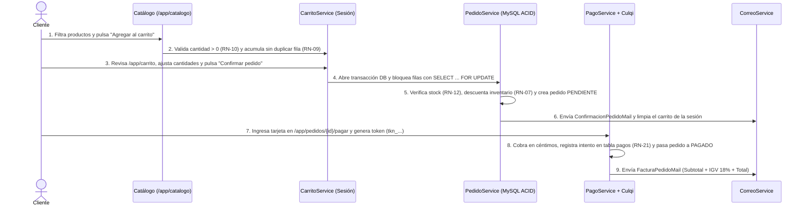

# Trabajo Final: Proyecto de Investigación Aplicada en E-Business

---

## Carátula

- **Institución:** Instituto Superior SISE
- **Carrera profesional:** Desarrollo de Sistemas de Información
- **Curso:** E-Business
- **Título del proyecto:** *VetPet Connect: Portal Integral de Comercio Electrónico B2C, Suscripción Recurrente e Historia Clínica Digital para VetPet Surco E.I.R.L.*
- **Integrantes (Equipo 4):**
  - *[Apellido, Nombre — Integrante 1]*
  - *[Apellido, Nombre — Integrante 2]*
  - *[Apellido, Nombre — Integrante 3]*
  - *[Apellido, Nombre — Integrante 4]*
- **Ciclo y año académico:** Semestre VI — 2026
- **Sede / Ciudad:** Lima, Perú

---

## Introducción

### Breve descripción de la empresa elegida

**VetPet Surco E.I.R.L.** (nombre comercial **VetPet Surco**, RUC referencial `20609512847`) es una micro y pequeña empresa (MYPE) peruana ubicada en la Av. Velasco Astete 1245, distrito de Santiago de Surco, Lima. Su actividad principal articula dos líneas de negocio complementarias: la comercialización minorista de artículos para mascotas (*pet shop*: alimento balanceado para perros y gatos, arena sanitaria, accesorios y medicamentos veterinarios de venta libre) y la prestación de servicios de salud animal básica (consulta general, vacunación, desparasitación y baño/grooming). La empresa opera con un local físico y un equipo de seis colaboradores: dos médicos veterinarios, un especialista en grooming y tres encargados de tienda y atención en mostrador.

### Objetivos del proyecto

- **Objetivo general:** Implementar una plataforma integral de comercio electrónico **B2C** denominada **VetPet Connect** que articule la venta en línea de productos con pasarela de pagos, un modelo de suscripción mensual de despacho recurrente y una historia clínica digital con alertas automáticas de salud, con el propósito de estabilizar los ingresos mensuales de VetPet Surco E.I.R.L. y elevar la retención de sus clientes durante el primer año de operación.
- **Objetivos específicos:**
  1. **Incrementar en +30 % el volumen de ventas mensuales recurrentes** de alimento balanceado y arena sanitaria en un plazo de **6 meses**, mediante la contratación de planes de suscripción mensual por mascota.
  2. **Reducir en −40 % las inasistencias y atrasos** en controles de vacunación y desparasitación en un plazo de **12 meses**, mediante el envío automatizado de recordatorios generados desde la historia clínica digital.
  3. **Automatizar al 100 % el descuento de inventario en tiempo real** por cada pedido confirmado en un plazo de **3 meses**, eliminando la sobreventa y los quiebres de stock no planificados en los productos de alta rotación.

### Enfoque y alcance de la solución web planteada

La solución **VetPet Connect** se diseñó y construyó como una aplicación web transaccional sobre **Laravel 12 (PHP 8.2)** y **MySQL 8.0**, desplegable en contenedores **Docker** (Apache 2.4 con SSL/TLS, MySQL 8.0 y MailHog). Su alcance comprende:

1. **Sitio institucional público:** Cuatro secciones informativas optimizadas para buscadores (*Inicio*, *Nosotros*, *Productos y Servicios*, y *Contacto* con envío de consultas al buzón corporativo).
2. **Plataforma transaccional con acceso por roles (RBAC):**
   - **Módulo del Cliente (`CLIENTE`):** Catálogo filtrable con semáforo de disponibilidad, carrito de compras persistente en sesión, confirmación transaccional del pedido, pago en línea con tarjeta mediante **Culqi**, registro de mascotas, contratación/pausa/cancelación de planes de suscripción mensual, reserva de citas veterinarias sin cruce de horarios y asistente virtual integrado (**Pelusa**).
   - **Módulo del Médico Veterinario (`VETERINARIO`):** Agenda del día, cierre de citas según desenlace (`ATENDIDA`, `CANCELADA`, `NO_ASISTIO`) y registro de la atención en la historia clínica digital con programación del próximo control.
   - **Módulo del Administrador (`ADMIN`):** Tablero de indicadores (ventas totales, ventas recurrentes por suscripción, suscripciones activas y productos por reponer), alta de productos en catálogo, control de inventario con semáforo de reposición, gestión secuencial de estados de pedidos y monitoreo de alertas clínicas próximas.

---

## Capítulo I: Planeamiento Estratégico y Modelos de Negocio

### 1.1. Perfil e infraestructura de la empresa: Diagnóstico actual del negocio

Antes de la implementación de **VetPet Connect**, la operación de VetPet Surco se realizaba de manera íntegramente presencial y manual, presentando cinco cuellos de botella operativos y comerciales:

| Área operativa | Situación previa (diagnóstico) | Impacto en el negocio |
| :--- | :--- | :--- |
| **Agenda veterinaria** | Coordinación por llamadas telefónicas y WhatsApp personal sin agenda centralizada. | Cruces de horario entre los dos veterinarios y pérdida de citas fuera del horario de oficina. |
| **Historia clínica** | Fichas físicas de cartón archivadas en el local. | Deterioro o extravío de antecedentes médicos e imposibilidad de consulta remota. |
| **Control de inventario** | Registro manual en cuaderno y hojas de cálculo sin conexión con las ventas. | Quiebres de stock en quincena/fin de mes en alimento balanceado y sobre-stock en accesorios. |
| **Canal comercial** | Venta exclusiva en mostrador físico. | Alta dependencia del tráfico peatonal de la zona y marcada estacionalidad de los ingresos. |
| **Fidelización y recompra** | Ausencia de alertas de vacunación y de recordatorios de reposición de alimento. | Dueños que olvidan las fechas de refuerzo de vacunas o compran el alimento de urgencia en supermercados. |

### 1.2. Planeamiento estratégico: Visión, misión, objetivos del negocio y planteamiento del caso

- **Misión:** Brindar atención veterinaria preventiva de calidad y abastecimiento confiable de alimentos, medicamentos y accesorios para mascotas en Santiago de Surco, integrando calidez humana con una plataforma digital que simplifique el cuidado oportuno de cada animal.
- **Visión:** Consolidarse hacia el 2028 como el centro veterinario y *pet shop* líder en innovación digital de Lima Sur, reconocido por su modelo de suscripción nutricional recurrente y su trazabilidad clínica en línea.
- **Valores corporativos:**
  1. *Prevención clínica:* Priorizar el calendario sanitario al día antes que la urgencia médica.
  2. *Transparencia comercial:* Precios claros en soles (IGV incluido), stock verídico y comprobantes inmediatos.
  3. *Compromiso continuo:* Acompañar al dueño durante toda la vida de su mascota.
- **Planteamiento del caso:** VetPet Surco cuenta con clientela fiel en su zona de influencia, pero pierde gran parte del gasto mensual recurrente en alimentación (que representa más del 65 % del presupuesto anual de un dueño de mascota) frente a cadenas grandes o aplicaciones de reparto porque carece de un canal digital de recompra programada. El proyecto transforma la compra esporádica en mostrador en una relación digital continua mediante suscripciones automatizadas y alertas médicas vinculadas al expediente de cada mascota.

### 1.3. Modelo de negocio electrónico: Definición del modelo e-Business seleccionado y justificación

La plataforma **VetPet Connect** responde al modelo **B2C (*Business to Consumer*)** con ingresos mixtos (**venta transaccional minorista (*e-tailing*) + modelo de suscripción recurrente**). Su selección se justifica técnica y comercialmente por tres razones:

1. **Relación directa empresa–consumidor final:** La transacción comercial (productos de *pet shop*, planes mensuales y reserva de consultas) se perfecciona directamente entre **VetPet Surco E.I.R.L.** y el propietario de la mascota (persona natural consumidora final), sin intermediarios mayoristas.
2. **Escala uno-a-muchos con personalización:** Un único catálogo y tarifario público atiende de forma simultánea a cientos de hogares del distrito, adaptando la oferta según la ficha de cada mascota registrada (especie `PERRO` o `GATO`, peso y edad).
3. **Oportunidad en el mercado peruano:** El mercado de cuidado de mascotas en el Perú proyecta un crecimiento de US\$ 456 millones a US\$ 680 millones entre 2023 y 2028, con más del 60 % de hogares peruanos conviviendo con al menos una mascota; sin embargo, el canal de comercio electrónico concentra apenas el 7 % de las ventas del sector. Digitalizar el servicio en un distrito de alta densidad como Santiago de Surco otorga una ventaja competitiva inmediata.

### 1.4. Integración de la gestión empresarial: CRM, ERP, SRM y E-Procurement

La arquitectura de **VetPet Connect** unifica los procesos externos (de cara al cliente) e internos (inventario y abastecimiento) sobre una única base de datos relacional:

- **Estrategia e importancia del CRM (*Customer Relationship Management*):**
  El núcleo del CRM gira alrededor del binomio **Dueño (`usuarios`) – Mascota (`mascotas`)**. Al registrarse, el cliente crea el perfil de cada mascota (nombre, especie, raza, peso) y el sistema consolida automáticamente su historial de pedidos, sus planes de suscripción activos, sus citas reservadas y su historia clínica (`historias_clinicas`). A partir del campo `proxima_fecha` registrado por el veterinario tras cada vacunación o desparasitación, el comando programado `vetpet:recordatorios` identifica los controles que vencen en los próximos 15 días (**RN-20**) y envía alertas personalizadas por correo electrónico, incrementando la retención y la visita recurrente al consultorio. Asimismo, el asistente virtual **Pelusa** actúa como canal de atención automatizado 24/7 que consulta en vivo el estado de los pedidos, citas y suscripciones del cliente.
- **Fundamentos del ERP (*Enterprise Resource Planning*) y SRM (*Supplier Relationship Management*):**
  Cada venta confirmada en el portal —ya sea una compra puntual del carrito (`PUNTUAL`) o un pedido emitido por el motor de suscripciones (`SUSCRIPCION`)— descuenta en tiempo real la columna `stock_actual` de la tabla `productos` dentro de una transacción ACID. El módulo administrativo (ERP) centraliza la facturación, diferencia los ingresos puntuales de los recurrentes (**RN-14**) y controla el flujo logístico del pedido (`PENDIENTE` → `PAGADO` → `ENVIADO` → `ENTREGADO`, **RN-13**). De cara a los proveedores (SRM), el sistema compara continuamente el `stock_actual` contra el `punto_reorden` de cada SKU para anticipar las necesidades de reabastecimiento con distribuidores de alimento y laboratorios veterinarios.
- **Análisis del modelo *E-Procurement* para los procesos de compra y venta:**
  En el aprovisionamiento electrónico (*E-Procurement*), **VetPet Connect** implementa un mecanismo automatizado de detección de reposición mediante el servicio `InventarioService` (**RN-08**), que clasifica el catálogo en tres niveles de semáforo:
  - **VERDE:** `stock_actual > punto_reorden * 2` (abastecimiento normal).
  - **AMARILLO:** `stock_actual > punto_reorden` y `<= punto_reorden * 2` (alerta preventiva de compra).
  - **ROJO:** `stock_actual <= punto_reorden` (requerimiento urgente de reposición).
  El panel del Administrador filtra automáticamente los productos en estado `ROJO` y `AMARILLO` (`porReponer()`), generando la orden de reposición estandarizada por código SKU para los proveedores. Esto estandariza el ciclo de compras, reduce costos administrativos y garantiza que los despachos programados de las suscripciones mensuales cuenten siempre con stock disponible.

---

## Capítulo II: Arquitectura, Diseño y Contenidos Web

### 2.1. Arquitectura de la aplicación: Estructura técnica de la solución e-Business

La plataforma fue construida bajo una **arquitectura multicapa en contenedores Docker**, empleando el patrón **MVC extendido con una Capa de Servicios de Dominio**:

1. **Capa de Infraestructura (`docker/`):**
   - **Servidor de Aplicación (`app`):** Contenedor basado en `php:8.2-apache` con Apache 2.4 (`mod_rewrite`, `mod_ssl`, VirtualHosts en puertos `80` y `443`) y extensiones PHP (`pdo_mysql`, `intl`, `gd`, `zip`, `imagick`).
   - **Servidor de Base de Datos (`db`):** Motor relacional **MySQL 8.0** con codificación `utf8mb4_unicode_ci`, persistencia en volumen dedicado y comprobación de salud (`healthcheck`).
   - **Servidor SMTP de Pruebas (`mailhog`):** Contenedor **MailHog** (puerto SMTP `1025` y panel web `8025`) para auditar el envío de los correos transaccionales y recordatorios clínicos.
2. **Capa de Presentación (`resources/views/` y `public/`):**
   - Plantillas **Laravel Blade** divididas en dos layouts (`layouts/publico.blade.php` para el portal institucional y `layouts/app.blade.php` para la plataforma transaccional), hojas de estilo CSS3 nativas (`estilos.css` y `app.css`) y el cliente JavaScript ligero del asistente (`pelusa.js`).
3. **Capa de Controladores y Validación HTTP (`app/Http/`):**
   - **11 Controladores** (`PaginaPublicaController`, `AutenticacionController`, `CatalogoController`, `CarritoController`, `PagoController`, `CitaController`, `MascotaController`, `SuscripcionController`, `ClinicaController`, `AdminController`, `AyudaController`), protegidos por el middleware de autorización por rol `EnsureRol` y clases `FormRequest` dedicadas (`RegistroRequest`, `AgregarAlCarritoRequest`, `ReservarCitaRequest`, `RegistrarAtencionRequest`, `CrearProductoRequest`).
4. **Capa de Servicios de Dominio (`app/Services/`):**
   - Concentra toda la lógica transaccional y las 22 reglas de negocio, desacoplándola de los controladores: `CarritoService`, `PedidoService`, `PagoService`, `PasarelaCulqi` / `PasarelaSimulada`, `SuscripcionService`, `DespachoService`, `AgendaService`, `HistoriaClinicaService`, `InventarioService`, `CorreoService` y el motor lingüístico del chatbot en `app/Services/Asistente/` (`AsistenteService`, `Clasificador`, `Normalizador`, `Lexico`, `CatalogoIndice`).
5. **Capa de Persistencia de Datos (`app/Models/` y `database/migrations/`):**
   - **9 modelos Eloquent y 9 tablas de dominio en MySQL**: `usuarios`, `mascotas`, `productos`, `pedidos`, `detalle_pedidos`, `suscripciones`, `citas`, `historias_clinicas` y `pagos`, reforzadas con restricciones `FOREIGN KEY`, `UNIQUE` y `CHECK` en el propio motor de base de datos.

### 2.2. Diseño de interfaces y tecnologías web: Usabilidad y tecnologías utilizadas

El diseño de interfaz (UI/UX) se guio por las siguientes recomendaciones de usabilidad y estándares web:

- **Diseño Responsivo (*Mobile-First*, RNF-01):** Dado que la mayoría de los propietarios de mascotas consulta precios o agenda citas desde su teléfono móvil, la maquetación utiliza **CSS Grid**, **Flexbox** y variables personalizadas CSS (`--verde`, `--verde-oscuro`, `--ambar`, `--crema`), con un punto de quiebre en `760px` que transforma las tablas de datos en tarjetas apiladas legibles en pantallas pequeñas y convierte el menú superior en un menú desplegable táctil.
- **Rendimiento y Carga Rápida (RNF-04):** Se prescindió de librerías pesadas de terceros en el frontend. Toda la iconografía (`logo.svg`, `portada-mascotas.svg`, iconos de categorías y servicios) está vectorizada en **SVG**, logrando que las páginas institucionales pesen pocos kilobytes y carguen en menos de 3 segundos en redes móviles 4G.
- **Accesibilidad Web (WCAG):** Uso estricto de etiquetas semánticas **HTML5** (`<header>`, `<nav>`, `<main>`, `<section>`, `<article>`, `<footer>`), enlace de salto directo al contenido principal (*"Saltar al contenido"*), atributo `aria-current="page"` en la navegación activa, cabeceras de tabla con `scope="col"`, foco de teclado visible (`:focus-visible`) y respeto por la preferencia del sistema `prefers-reduced-motion`.
- **Retroalimentación inmediata:** Componente de notificaciones flotantes (`components/aviso.blade.php`) que informa al usuario el resultado de cada operación o la regla de negocio específica que impidió una acción inválida.

### 2.3. Generación de contenidos: Contenidos estáticos y contenidos dinámicos

La solución combina estratégicamente contenidos estáticos (para posicionamiento e información institucional) y contenidos dinámicos (para la operación transaccional en tiempo real):

1. **Implementación de contenidos estáticos (`PaginaPublicaController` / `resources/views/publico/`):**
   - **Inicio (`inicio.blade.php`):** Presenta la propuesta de valor de VetPet Connect (tienda en línea, suscripción mensual e historia clínica digital), accesos directos y resumen de servicios veterinarios.
   - **Nosotros (`nosotros.blade.php`):** Reseña histórica de VetPet Surco, ficha corporativa (razón social, RUC, dirección en Av. Velasco Astete 1245), misión, visión, valores y presentación del equipo médico y de tienda.
   - **Productos y Servicios (`productos.blade.php`):** Vitrina informativa por categorías, tarifario transparente de servicios clínicos (consulta general S/ 50, vacunación S/ 65, desparasitación S/ 35, baño y grooming S/ 60) y comparativa de los tres planes de suscripción mensual.
   - **Contacto (`contacto.blade.php`):** Dirección, horarios de atención (lunes a sábado de 9:00 a. m. a 8:00 p. m.), canales de atención y formulario de contacto clasificado por motivo con protección anti-spam (`throttle:10,1`).
2. **Implementación de contenidos dinámicos (`resources/views/app/`):**
   - **Catálogo con stock en tiempo real (`catalogo.blade.php`):** Consulta los productos activos en MySQL, permite filtrar por categoría (`ALIMENTO`, `MEDICAMENTO`, `ACCESORIO`) y calcula dinámicamente el semáforo de disponibilidad (`En stock`, `Últimas unidades`, `Agotado`), bloqueando el botón de compra cuando `stock_actual === 0`.
   - **Carrito y pasarela de pago (`carrito.blade.php`, `pago.blade.php`):** Calcula subtotales al vuelo en céntimos enteros, genera la boleta con desglose de **Subtotal + IGV (18 %) + Total** y muestra el historial en vivo de intentos de pago registrados en la tabla `pagos`.
   - **Agenda médica interactiva (`citas.blade.php`):** Cruza el médico veterinario y la fecha seleccionada contra la tabla `citas` para deshabilitar en tiempo real los bloques horarios ya reservados.
   - **Asistente virtual Pelusa (`components/chatbot.blade.php` + `AsistenteService.php`):** Combina un clasificador léxico en español (con raíces morfológicas *Snowball Stemmer*, diccionario de sinónimos y corpus de entrenamiento) con consultas dinámicas a la cuenta del cliente para responder sobre el stock real de un producto, sus pedidos recientes, sus mascotas o sus próximas citas.

### 2.4. Modelo implementado (según el rubro de la empresa): Detalles de la Tienda Virtual (E-commerce)

Por la naturaleza del giro de **VetPet Surco E.I.R.L.**, se implementó una **Tienda Virtual (E-commerce B2C) especializada en salud y nutrición animal**, diseñada sobre tres pilares transaccionales interconectados:

1. **Comercio electrónico de productos (*E-tailing*):** Permite al dueño de mascota adquirir alimentos, medicamentos OTC y accesorios las 24 horas del día, con validación transaccional de stock y pago electrónico con tarjeta.
2. **Suscripción mensual automatizada (*Subscription E-commerce*):** El cliente afilia a su mascota a uno de los tres planes mensuales (`BASICO` a S/ 99.00 por 1 unidad, `CUIDADO` a S/ 149.00 por 2 unidades, o `INTEGRAL` a S/ 219.00 por 3 unidades cada 30 días). Todos los días a las 03:00 a. m., el proceso programado `suscripciones:despachar` evalúa las suscripciones cuya fecha `proximo_despacho` ha vencido, emite automáticamente el pedido con origen `SUSCRIPCION`, descuenta el inventario, avanza la fecha al siguiente ciclo de 30 días y notifica al cliente por correo electrónico.
3. **E-commerce de servicios veterinarios e historia clínica:** Integra la reserva digital de citas con el expediente clínico electrónico de la mascota, cerrando el ciclo de fidelización mediante alertas sanitarias automáticas.

---

## Capítulo III: Reglas de Negocio, Pasarela de Pagos y Carrito de Compras

### 3.1. Reglas del negocio electrónico

El flujo de ventas, suscripciones, inventario y atención clínica está gobernado por **22 reglas de negocio explícitas**, verificadas tanto en la capa de servicios de Laravel como mediante restricciones `CHECK`, `UNIQUE` y `FOREIGN KEY` en MySQL, y respaldadas por una suite de pruebas automatizadas en PHPUnit:

| Código | Regla de negocio | Implementación técnica (Laravel + MySQL) |
| :--- | :--- | :--- |
| **RN-01** | Cada usuario tiene un único rol excluyente (`CLIENTE`, `VETERINARIO`, `ADMIN`). | `ENUM` en `usuarios.rol` + middleware `EnsureRol`. |
| **RN-02** | El correo electrónico identifica a una sola cuenta. | Índice `UNIQUE (correo)` en `usuarios` + `RegistroRequest`. |
| **RN-03** | La contraseña nunca se almacena en texto plano. | Hash `BCrypt` (`Hash::make`) en `usuarios.password_hash`. |
| **RN-04** | Toda mascota pertenece obligatoriamente a un cliente registrado. | `FOREIGN KEY (cliente_id)` hacia `usuarios`. |
| **RN-05** | Cada producto posee un código SKU único e irrepetible. | Índice `UNIQUE (codigo_sku)` en `productos`. |
| **RN-06** | Ningún producto puede registrarse ni venderse con precio `<= 0`. | Restricción `CHECK (precio > 0)` + `CrearProductoRequest`. |
| **RN-07** | El stock de un producto nunca puede quedar en negativo. | Restricción `CHECK (stock_actual >= 0)` + `InventarioService`. |
| **RN-08** | El semáforo de inventario alerta cuándo reponer (`ROJO <= punto_reorden`). | `InventarioService::semaforo()` y `porReponer()`. |
| **RN-09** | Un producto aparece una sola vez por pedido (se acumula la cantidad). | Índice `UNIQUE uk_linea_pedido (pedido_id, producto_id)` + `CarritoService`. |
| **RN-10** | No se admiten cantidades menores o iguales a cero en el carrito o pedido. | Restricción `CHECK (cantidad > 0)` + `CantidadInvalidaException`. |
| **RN-11** | El detalle del pedido conserva el precio unitario histórico de la compra. | Columna `detalle_pedidos.precio_unitario` copiada al confirmar. |
| **RN-12** | Sin stock suficiente para todos los ítems no se emite el pedido (atomicidad). | Transacción con bloqueo `SELECT ... FOR UPDATE` en `PedidoService::confirmar()`. |
| **RN-13** | El pedido avanza secuencialmente sin saltar estados (`PENDIENTE` → `PAGADO` → `ENVIADO` → `ENTREGADO`). | `EstadoPedido::siguiente()` + `PedidoService::avanzarEstado()`. |
| **RN-14** | Todo pedido distingue si proviene de compra `PUNTUAL` o de `SUSCRIPCION`. | Columna `pedidos.tipo_origen` asignada por el sistema. |
| **RN-15** | El cliente puede pausar, reactivar o cancelar su suscripción en cualquier momento. | `SuscripcionService::cambiarEstado()`. Las pausadas no generan despachos. |
| **RN-16** | Toda suscripción registra su frecuencia en días y calcula su próximo despacho. | Columnas `frecuencia_dias` (30) y `proximo_despacho` en `suscripciones`. |
| **RN-17** | Un médico veterinario no puede tener dos citas en la misma fecha y hora. | Índice `UNIQUE uk_agenda (veterinario_id, fecha_hora)` + `AgendaService`. |
| **RN-18** | Toda cita finaliza registrando su desenlace (`ATENDIDA`, `CANCELADA`, `NO_ASISTIO`). | `AgendaService::cerrar()` validando que provenga de `RESERVADA`. |
| **RN-19** | Cada cita atendida genera como máximo un único registro de historia clínica. | Índice `UNIQUE (cita_id)` en `historias_clinicas` + `HistoriaClinicaService`. |
| **RN-20** | El sistema alerta los controles médicos programados dentro de los próximos 15 días. | `HistoriaClinicaService::recordatorios(15)` + comando `vetpet:recordatorios`. |
| **RN-21** | Un pedido solo pasa a `PAGADO` si la pasarela aprueba el cargo, auditando todo intento. | Tabla `pagos` (`APROBADO`/`RECHAZADO`) + `PagoService::cobrar()`. |
| **RN-22** | Una mascota no puede tener dos suscripciones vigentes (`ACTIVA`/`PAUSADA`) del mismo producto. | Validación de unicidad en `SuscripcionService::contratar()`. |

### 3.2. Simulación del carrito de compras: Flujo desde la selección hasta el checkout

El proceso de compra en **VetPet Connect** fue diseñado para completarse en pasos claros y seguros:

1. **Selección en el Catálogo (`/app/catalogo`):** El cliente visualiza el precio en Soles (`S/`) y la disponibilidad. Al agregar un ítem, `CarritoService::agregar()` verifica que la cantidad sea entera positiva (**RN-10**) y que no supere el stock disponible. Si el producto ya estaba en el carrito, suma las unidades en la misma línea (**RN-09**).
2. **Cálculo exacto en céntimos (`/app/carrito`):** Para evitar errores de redondeo en coma flotante (IEEE 754), `CarritoService` convierte cada precio unitario a **céntimos enteros** (`S/ 189.90` → `18990` céntimos), multiplica por la cantidad y convierte el resultado final a formato decimal `0.00`.
3. **Confirmación transaccional (`POST /app/carrito/confirmar`):** `PedidoService::confirmar()` ordena los IDs de los productos (evitando *deadlocks*), abre una transacción en MySQL y ejecuta `lockForUpdate()` (`SELECT ... FOR UPDATE`) sobre las filas de `productos`. Si algún producto no cuenta con stock suficiente, aborta toda la operación (`ROLLBACK`) e informa qué producto falló (**RN-12**). Si todos cumplen, registra la cabecera en `pedidos` (estado `PENDIENTE`, origen `PUNTUAL`), inserta las líneas en `detalle_pedidos` y descuenta `stock_actual`.
4. **Checkout y Comprobante (`/app/pedidos/{pedido}/pagar`):** El cliente es dirigido a la pantalla de pago donde visualiza la boleta detallada con la base imponible, el **IGV (18 %)** y el total a pagar, procediendo al cobro con tarjeta.

### 3.3. Pasarela de pagos y normativa aplicable al consumidor

#### Configuración técnica de la pasarela de pagos (Culqi)

La plataforma implementa el patrón *Strategy / Adapter* mediante la interfaz [`Pasarela`](file:///c:/Users/USUARIO/Desktop/VetPetSurco/public_html/app/Services/Pasarela.php), con dos implementaciones intercambiables:

- **`PasarelaCulqi` (Producción / Integración real):** Utiliza **Culqi Checkout v4** en el navegador para capturar los datos de la tarjeta (Visa o Mastercard) y generar un token de un solo uso (`tkn_...`). De esta forma, **los números de tarjeta y códigos CVV jamás tocan ni se almacenan en el servidor de VetPet Surco**, cumpliendo con las buenas prácticas de **PCI-DSS**. El backend recibe únicamente el token y realiza una petición `POST https://api.culqi.com/v2/charges` autenticada con la llave privada (`CULQI_LLAVE_SECRETA`), enviando el monto en céntimos y `currency_code = PEN`.
- **`PasarelaSimulada` (Entorno de pruebas y demostración):** Permite simular en el aula tarjetas aprobadas (Visa `tkn_sim_visa_4242`, Mastercard `tkn_sim_mc_5454`) y tarjetas rechazadas por fondos insuficientes (`tkn_sim_rechazo_fondos`), verificando que todo intento quede auditado en la tabla `pagos` (**RN-21**) y que solo un cargo `APROBADO` cambie el pedido a `PAGADO` y dispare el envío del comprobante electrónico (`FacturaPedidoMail`).

#### Normativa legal y protección al consumidor en el Perú

1. **Ley N.° 29733 — Ley de Protección de Datos Personales y su Reglamento:**
   - Minimización de datos recolectados (nombre, correo, teléfono y dirección de despacho).
   - Almacenamiento irreversible de contraseñas mediante algoritmo `BCrypt` (**RN-03 / RNF-02**) y aislamiento estricto de la información de cada cliente y sus mascotas (**RN-04**).
2. **Ley N.° 29571 — Código de Protección y Defensa del Consumidor (INDECOPI):**
   - **Transparencia de precios:** Todos los precios del catálogo y planes se muestran en moneda nacional (**Soles, `S/`**) incluyendo impuestos.
   - **Respeto del precio informado (**RN-11**):** El precio unitario queda registrado en `detalle_pedidos`, garantizando que modificaciones posteriores en el catálogo no alteren pedidos ya confirmados.
   - **Libertad de desafiliación (**RN-15**):** El consumidor puede pausar o cancelar su suscripción mensual con un solo clic desde su panel, sin penalidades ni trabas administrativas.
   - **Comprobante electrónico:** Emisión automática por correo del detalle de la compra con desglose de Subtotal, IGV (18 %) y Total.

---

## Capítulo IV: Seguridad, Gestión de Contenidos y Marketing Digital

### 4.1. Seguridad en transacciones electrónicas

Para garantizar la confidencialidad, integridad y disponibilidad de las operaciones, se implementaron las siguientes medidas de seguridad en profundidad:

1. **Cifrado de canal mediante Certificados SSL/TLS (HTTPS):**
   El contenedor Apache cuenta con el módulo `mod_ssl` habilitado ([`docker/default-ssl.conf`](file:///c:/Users/USUARIO/Desktop/VetPetSurco/docker/default-ssl.conf)) y generación automatizada de certificados X.509 RSA de 2048 bits (`docker/generar-certificados.sh`), cifrando el tráfico en el puerto `443` entre el navegador del cliente y el servidor.
2. **Cifrado de contraseñas y gestión segura de sesiones:**
   Las credenciales de acceso se almacenan aplicando *hashing* con sal aleatoria mediante **BCrypt** (`Hash::make()`). Al iniciar o cerrar sesión (`AutenticacionController`), el sistema ejecuta `$request->session()->regenerate()` e `invalidate()` para prevenir ataques de **fijación de sesión (*Session Fixation*)**, manteniendo las cookies de sesión con bandera `HttpOnly` y `SameSite=lax`.
3. **Protección contra falsificación de peticiones (CSRF), XSS e Inyección SQL:**
   - **CSRF:** Todos los formularios que modifican estado (`POST`, `PATCH`, `DELETE`) incluyen el token criptográfico `@csrf` verificado por Laravel.
   - **Prevención de SQL Injection:** Uso exclusivo de consultas parametrizadas (*Prepared Statements* en PDO/Eloquent) en todos los servicios y controladores.
   - **Prevención de XSS:** Escape automático de salidas HTML con `{{ ... }}` en Blade e inserción segura mediante `textContent` en el asistente JavaScript (`pelusa.js`).
   - **Limitación de tasa (*Rate Limiting*):** Protección contra abuso y spam con middleware `throttle` en el formulario de contacto (`throttle:10,1`) y en las consultas al asistente (`throttle:30,1`).
4. **Control de acceso basado en roles (RBAC) y propiedad de recursos:**
   El middleware [`EnsureRol`](file:///c:/Users/USUARIO/Desktop/VetPetSurco/public_html/app/Http/Middleware/EnsureRol.php) bloquea con código HTTP `403 Forbidden` cualquier intento de acceder a rutas de otro perfil, y los controladores validan que un cliente solo pueda pagar sus propios pedidos, reservar citas para sus propias mascotas o modificar sus propias suscripciones.
5. **Seguridad transaccional ACID y bloqueos pesimistas en base de datos:**
   El uso de `DB::transaction()` combinado con `SELECT ... FOR UPDATE` sobre las filas de productos asegura aislamiento frente a compras concurrentes (**RNF-03**), mientras que las restricciones `CHECK (precio > 0)`, `CHECK (stock_actual >= 0)` y `CHECK (cantidad > 0)` impiden estados corruptos incluso ante accesos directos al motor MySQL.

### 4.2. Gestor de contenidos (CMS) y plataforma de administración

Durante el diseño arquitectónico se evaluó el uso de un CMS tradicional con plugin de tienda (como WordPress + WooCommerce o PrestaShop). Sin embargo, se descartó porque **un CMS genérico de páginas y productos no modela de forma nativa la relación clínica entre un cliente, sus múltiples mascotas, las suscripciones mensuales por mascota, la agenda médica por veterinario y la historia clínica con alertas de vacunación**.

En su lugar, se implementó un **Panel de Gestión de Contenidos y Operaciones a medida sobre Laravel 12** (`/app/admin`, controlado por [`AdminController`](file:///c:/Users/USUARIO/Desktop/VetPetSurco/public_html/app/Http/Controllers/AdminController.php)), cuyo entorno permite al personal de VetPet Surco:

- **Administración del catálogo de productos:** Alta de nuevos productos validando código SKU único (**RN-05**), categoría (`ALIMENTO`, `MEDICAMENTO`, `ACCESORIO`), precio positivo (**RN-06**), stock inicial (**RN-07**) y punto de reorden.
- **Monitoreo del semáforo de inventario:** Visualización inmediata del estado de cada artículo (`VERDE`, `AMARILLO`, `ROJO`) para ejecutar las compras de reposición.
- **Gestión del flujo de pedidos:** Tablero de órdenes que distingue compras puntuales de despachos por suscripción (**RN-14**) y permite avanzar el estado logístico paso a paso (`PAGADO` → `ENVIADO` → `ENTREGADO`, **RN-13**).
- **Supervisión de KPIs y alertas clínicas:** Tarjetas en vivo con el monto de venta registrada, ingreso recurrente, total de suscripciones activas, productos por reponer y listado de mascotas cuyos controles de salud vencen en los próximos 15 días (**RN-20**).

### 4.3. Estrategia de E-Marketing, Newsletters y Alta en Buscadores (SEO)

#### 1. Plan de posicionamiento digital y redes sociales (E-Marketing)
- **Captación local segmentada:** Campañas en Instagram y TikTok orientadas a dueños de mascotas residentes en **Santiago de Surco y distritos aledaños (San Borja, Miraflores, La Molina)**, con contenido educativo elaborado por los médicos veterinarios del local (calendarios de vacunación, nutrición según etapa de vida y cuidados de higiene).
- **Conversión hacia ingresos recurrentes:** Promoción de los planes de suscripción mensual (*"Nunca más te quedes sin alimento en quincena"*) y uso del asistente virtual **Pelusa** en el portal para guiar al visitante hacia la compra o la reserva de su primera consulta.

#### 2. Comunicaciones automatizadas por correo electrónico (Email Marketing y Fidelización)
La plataforma integra un sistema de **8 flujos de correo electrónico** con identidad visual corporativa (plantillas HTML con estilos en línea en `resources/views/emails/` y `CorreoService`), que cumplen el rol de boletines transaccionales y de retención:
- **Bienvenida (`BienvenidaMail`):** Se envía automáticamente al registrarse, presentando los beneficios de la tienda, la agenda en línea y los planes de suscripción.
- **Confirmación de pedido y Comprobante de pago (`ConfirmacionPedidoMail`, `FacturaPedidoMail`):** Acompañan todo el ciclo de compra del cliente.
- **Gestión y despacho de suscripciones (`CambioSuscripcionMail`, `DespachoSuscripcionMail`):** Notifican al cliente cada vez que se emite su pedido mensual automático o cuando modifica su plan.
- **Fidelización clínica (`ConfirmacionCitaMail`, `RecordatorioVacunaMail`):** El comando diario `vetpet:recordatorios` (08:00 a. m.) envía avisos preventivos 15 días antes de la fecha de próxima vacuna o desparasitación, logrando que el dueño regrese periódicamente a la veterinaria.

#### 3. Tácticas SEO y Alta en Buscadores
- **Optimización On-Page y HTML Semántico:** Todas las páginas públicas (`layouts/publico.blade.php`) definen títulos únicos (`<title>`), metadatos `<meta name="description">` específicos para búsquedas locales (*"Veterinaria y pet shop en Santiago de Surco..."*), jerarquía limpia de encabezados (`<h1>`, `<h2>`, `<h3>`), atributo `lang="es-PE"` y textos alternativos (`alt`) en imágenes.
- **Protocolo Open Graph para redes sociales:** Inclusión de etiquetas `og:title`, `og:description`, `og:type` y `og:locale` (`es_PE`) para enriquecer la vista previa cuando los enlaces de la tienda se comparten en WhatsApp, Facebook o Instagram.
- **Directivas para rastreadores (`robots.txt`) y alta en buscadores:** Configuración del archivo [`public/robots.txt`](file:///c:/Users/USUARIO/Desktop/VetPetSurco/public_html/public/robots.txt) (`User-agent: * / Disallow:`) para permitir la indexación de las páginas públicas, complementado con el registro del dominio en **Google Search Console** y **Google Business Profile (Google Maps)** para posicionar a VetPet Surco en búsquedas geolocalizadas (*"veterinaria en Surco"*, *"alimento para perros delivery Surco"*).

---

## Capítulo V: Entregable Digital (Publicación del Caso)

### 5.1. Enlace al Blog Corporativo

El caso de estudio completo de **VetPet Surco E.I.R.L. — VetPet Connect**, incluyendo el diagnóstico empresarial, la arquitectura e-Business B2C, el modelo transaccional y las evidencias visuales de funcionamiento, ha sido estructurado y publicado en el siguiente Blog Corporativo:

- **URL del Blog Corporativo:** `[Pegar aquí el enlace de tu blog en Blogger / WordPress / Notion, p. ej.: https://vetpetsurco-ebusiness.blogspot.com]`

### 5.2. Capturas de pantalla de la solución implementada

El repositorio incluye el conjunto completo de capturas del sitio institucional (`docs/capturas/`) y de los módulos transaccionales de la plataforma (`docs/capturas-reglas/`):

1. **Sitio Institucional Público (E-commerce y Servicios):**
   - **Portada e Inicio (Escritorio y Móvil):** [`docs/capturas/index.jpg`](file:///c:/Users/USUARIO/Desktop/VetPetSurco/docs/capturas/index.jpg) y [`docs/capturas/index-movil.jpg`](file:///c:/Users/USUARIO/Desktop/VetPetSurco/docs/capturas/index-movil.jpg) — Propuesta de valor B2C y diseño adaptable a dispositivos móviles (RNF-01).
   - **Nosotros y Perfil Corporativo:** [`docs/capturas/nosotros.jpg`](file:///c:/Users/USUARIO/Desktop/VetPetSurco/docs/capturas/nosotros.jpg) — Misión, visión, valores, equipo veterinario y datos de la MYPE.
   - **Vitrina de Productos, Tarifario y Planes de Suscripción:** [`docs/capturas/productos.jpg`](file:///c:/Users/USUARIO/Desktop/VetPetSurco/docs/capturas/productos.jpg).
   - **Contacto y Ubicación:** [`docs/capturas/contacto.jpg`](file:///c:/Users/USUARIO/Desktop/VetPetSurco/docs/capturas/contacto.jpg).
2. **Simulación del Carrito de Compras, Pasarela y Módulos por Rol:**
   - **Control de Acceso y Registro con Hash BCrypt (RN-01, RN-02, RN-03):** [`docs/capturas-reglas/01-ingreso.png`](file:///c:/Users/USUARIO/Desktop/VetPetSurco/docs/capturas-reglas/01-ingreso.png) y [`docs/capturas-reglas/02-registro.png`](file:///c:/Users/USUARIO/Desktop/VetPetSurco/docs/capturas-reglas/02-registro.png).
   - **Catálogo Dinámico y Selección de Productos (RN-05, RN-06, RN-08, RN-09):** [`docs/capturas-reglas/03-catalogo.png`](file:///c:/Users/USUARIO/Desktop/VetPetSurco/docs/capturas-reglas/03-catalogo.png).
   - **Simulación del Carrito de Compras, Confirmación y Bloqueo contra Sobreventa (RN-10, RN-11, RN-12):** [`docs/capturas-reglas/04-carrito.png`](file:///c:/Users/USUARIO/Desktop/VetPetSurco/docs/capturas-reglas/04-carrito.png) y [`docs/capturas-reglas/05-carrito-bloqueado.png`](file:///c:/Users/USUARIO/Desktop/VetPetSurco/docs/capturas-reglas/05-carrito-bloqueado.png).
   - **Agenda de Citas sin Cruce de Horarios (RN-17):** [`docs/capturas-reglas/06-agenda.png`](file:///c:/Users/USUARIO/Desktop/VetPetSurco/docs/capturas-reglas/06-agenda.png).
   - **Gestión de Mascotas y Planes de Suscripción Mensual (RN-04, RN-15, RN-16):** [`docs/capturas-reglas/07-mascotas.png`](file:///c:/Users/USUARIO/Desktop/VetPetSurco/docs/capturas-reglas/07-mascotas.png).
   - **Historia Clínica Digital y Programación de Próximo Control (RN-18, RN-19, RN-20):** [`docs/capturas-reglas/08-clinica.png`](file:///c:/Users/USUARIO/Desktop/VetPetSurco/docs/capturas-reglas/08-clinica.png).
   - **Panel Administrativo: Semáforo de Inventario, Flujo de Pedidos y Alta de Productos (RN-07, RN-08, RN-13, RN-14):** [`docs/capturas-reglas/09-inventario.png`](file:///c:/Users/USUARIO/Desktop/VetPetSurco/docs/capturas-reglas/09-inventario.png), [`docs/capturas-reglas/10-pedidos.png`](file:///c:/Users/USUARIO/Desktop/VetPetSurco/docs/capturas-reglas/10-pedidos.png) y [`docs/capturas-reglas/11-alta.png`](file:///c:/Users/USUARIO/Desktop/VetPetSurco/docs/capturas-reglas/11-alta.png).

---

## Conclusiones y Recomendaciones

### Conclusiones

1. **Ventaja competitiva mediante ingresos recurrentes predecibles:** La integración del modelo de suscripción mensual de alimento y arena sanitaria dentro de **VetPet Connect** permite a una MYPE local como VetPet Surco romper su dependencia del flujo peatonal del mostrador y competir con grandes cadenas mediante despachos programados cada 30 días.
2. **Sinergia entre salud animal (CRM) y comercio electrónico (ERP):** Vincular la historia clínica digital con alertas automáticas de vacunación (15 días antes del vencimiento) y con el inventario en tiempo real convierte la atención médica en un motor de fidelización que impulsa tanto la asistencia al consultorio como la recompra en la tienda virtual.
3. **Integridad transaccional como requisito indispensable del e-Commerce:** El uso combinado de transacciones ACID con bloqueo de fila (`SELECT ... FOR UPDATE`), aritmética en céntimos enteros, tokenización de pagos con **Culqi** y restricciones declarativas en MySQL (`CHECK` y `UNIQUE`) demostró ser fundamental para impedir la sobreventa de stock, los cruces de citas y las inconsistencias contables.
4. **Lecciones aprendidas en la alineación de TI con el negocio:** El desarrollo del proyecto evidenció que ninguna regla tecnológica tiene valor aislada de la operación: cada una de las 22 reglas de negocio implementadas y probadas nació directamente de un problema real del local (fichas de cartón extraviadas, citas duplicadas por WhatsApp y quiebres de inventario en quincena).

### Recomendaciones

1. **Despliegue en la nube con respaldos automatizados:** Publicar el entorno de contenedores Docker en un proveedor cloud (VPS o PaaS con MySQL administrado y certificado SSL Let's Encrypt), programando copias de seguridad diarias automatizadas de la base de datos fuera del servidor principal.
2. **Integración de medios de pago locales alternativos:** Complementar el cobro con tarjeta en **Culqi** habilitando billeteras digitales de alta adopción en el mercado peruano (**Yape** y **Plin**), reduciendo la fricción en el checkout para montos menores.
3. **Expansión omnicanal de las alertas del CRM:** Conectar el comando diario de recordatorios clínicos (`vetpet:recordatorios`) y los avisos de despacho de suscripciones con la API oficial de **WhatsApp Business**, complementando el canal de correo electrónico para elevar la tasa de lectura inmediata.

---

## Bibliografía

- Chaffey, D., & Ellis-Chadwick, F. (2019). *Digital marketing: Strategy, implementation and practice* (7.ª ed.). Pearson.
- Cisneros Canlla, E. (2017). *E-commerce: Comercio electrónico* (1.ª ed.). Editorial Macro.
- Congreso de la República del Perú. (2010). *Ley N.° 29571, Código de Protección y Defensa del Consumidor*. Diario Oficial El Peruano.
- Congreso de la República del Perú. (2011). *Ley N.° 29733, Ley de Protección de Datos Personales*. Diario Oficial El Peruano.
- Laudon, K. C., & Laudon, J. P. (2020). *Sistemas de información gerencial* (16.ª ed.). Pearson Educación.
- Laudon, K. C., & Traver, C. G. (2021). *E-commerce 2021: Business, technology, society* (16.ª ed.). Pearson.
- Turban, E., Outland, J., King, D., Lee, J. K., Liang, T. P., & Turban, D. C. (2018). *Electronic commerce 2018: A managerial and social networks perspective* (9.ª ed.). Springer.
